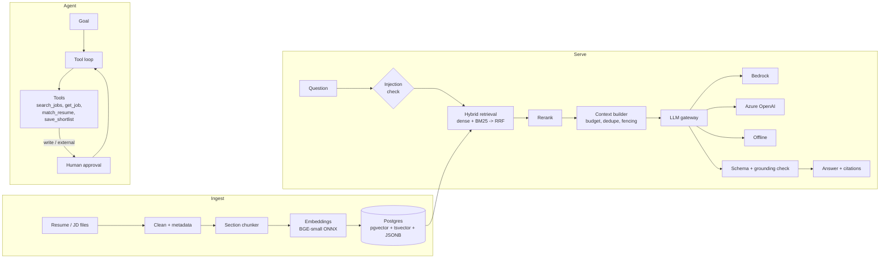

# BlueWhale GenAI

Resume and job-description intelligence: ingest documents, search them with hybrid retrieval, answer questions with citations, rank jobs for a candidate, and run a tool-calling agent that pauses for a human before it changes anything.

This is the AI core of BlueWhaleAI, a job-matching platform I started as my Cumberland University project. The production app has more around it (scrapers for job boards, a web front end, scheduling), but this repo holds the GenAI parts. It runs end to end on a laptop with no cloud account, and the same code switches to AWS Bedrock, Azure OpenAI and Postgres/pgvector through configuration.

```
make install && make test      # 49 tests, ~1s, no network
make eval                      # retrieval + answer + safety evals with a pass/fail gate
make api                       # http://localhost:8000/docs
docker compose up --build      # Postgres + pgvector, API and Streamlit UI
```

## What's inside

| Area | What it does | Where |
|---|---|---|
| **LLM gateway** | One interface over AWS Bedrock (Converse API), Azure OpenAI and an offline provider. Per-task routing, retries with jittered backoff, failover, a circuit breaker per provider, token and cost accounting. | `llm/gateway.py`, `llm/providers/` |
| **Prompts** | Versioned templates (`name@vN`), fingerprinted and attached to every trace so a quality change can be tied to a prompt change. | `llm/prompts.py`, `prompts/` |
| **Structured outputs** | JSON extraction from model text, Pydantic validation, one repair turn with the validation error. | `llm/structured.py` |
| **Tool calling** | Tools declare a Pydantic args model (sent to the model as JSON schema), a permission level and whether they need approval. Arguments are validated before anything runs. | `agents/tools.py` |
| **RAG ingestion** | Load .txt/.md/.pdf/.docx, clean (double-escaped HTML entities, control chars, page chrome, duplicated bodies), extract metadata (doc type, skills, seniority, years of experience), section-aware chunking with overlap, idempotent upserts by content hash. | `rag/documents.py`, `rag/chunking.py` |
| **Hybrid retrieval** | Dense (BGE-small via FastEmbed/ONNX) + keyword (BM25 in memory, `tsvector` in Postgres), fused with Reciprocal Rank Fusion, metadata filters, then a reranker (cross-encoder or lexical). | `rag/retriever.py`, `rag/store.py`, `rag/rerank.py` |
| **pgvector store** | One Postgres for vectors (HNSW), full-text (GIN) and metadata (JSONB). Hybrid search with filters is a single round trip. | `rag/store.py` |
| **Grounded answers** | Context packing under a token budget with dedupe and citation numbers; answers are checked against the cited blocks and refused if unsupported. | `rag/context.py`, `rag/service.py` |
| **Agentic workflow** | Bounded tool loop: step limit, loop guard, tool errors returned to the model, human approval for write/external tools, checkpoint + resume. | `agents/runner.py` |
| **Graph workflow** | Fixed job-matching graph (parse -> retrieve -> score -> widen if weak -> done) for the cases that don't need a model to plan. | `agents/job_match.py` |
| **Matching** | Explainable weighted score (semantic, skills, seniority, experience) where missing features are dropped and re-weighted instead of counted as zero. | `matching/` |
| **Security** | Prompt-injection scoring on questions and on retrieved chunks, untrusted-content fencing, PII redaction for logs, output grounding check, API keys, rate limiting, least-privilege IAM. | `guardrails.py`, `api/security.py`, `infra/` |
| **Observability** | Spans with trace ids, Prometheus metrics (latency, tokens, cost, refusals, tool errors), JSON logs, optional OpenTelemetry export, user feedback capture. | `observability.py`, `/metrics`, `/v1/feedback` |
| **Evaluation** | Labelled Q&A set; recall@k, MRR, answer hit rate, refusal rate on unanswerable/adversarial questions, groundedness. Runs in CI as a regression gate. | `evals/run.py`, `data/evals/` |
| **API + UI** | FastAPI service and a Streamlit app for Ask / Match / Agent (with approve/reject) / Add document. | `api/app.py`, `ui/` |
| **MCP** | Read-only tools exposed over the Model Context Protocol for MCP clients. | `mcp_server.py` |
| **Delivery** | Multi-stage Docker image (non-root), docker-compose, GitHub Actions (lint, tests, eval gate), Terraform for AWS (ECS Fargate + ALB + Bedrock) and Azure (Container Apps + Azure OpenAI with managed identity). | `Dockerfile`, `.github/`, `infra/` |

## Architecture



More detail and the reasoning behind the main choices: [docs/architecture.md](docs/architecture.md).

## API

| Method | Path | |
|---|---|---|
| POST | `/v1/documents` | ingest text (`doc_type` optional, auto-detected) |
| POST | `/v1/documents/upload` | ingest a .txt/.md/.pdf/.docx file |
| POST | `/v1/ask` | grounded Q&A, filters: `doc_type`, `skill` |
| POST | `/v1/match` | rank indexed jobs for a resume, with reasons |
| POST | `/v1/agent/runs` | start an agent run |
| GET | `/v1/agent/runs/{id}` | status, events, pending action |
| POST | `/v1/agent/runs/{id}/review` | approve / reject the pending action |
| POST | `/v1/feedback` | thumbs up/down tied to a trace id |
| GET | `/healthz` `/readyz` `/metrics` | probes and Prometheus metrics |

```bash
curl -s localhost:8000/v1/ask -H 'content-type: application/json' \
  -d '{"question": "Which job needs MLflow experiment tracking?"}' | jq '.answer, .citations[0].title'
```

## Evaluation

`python -m bluewhale.evals.run` loads the sample corpus and scores every question in `data/evals/qa.jsonl`. Swap `--mode dense|keyword|hybrid`, `--k`, or `--prompt-version` to compare variants. With `--gate` it exits non-zero when a metric drops below its threshold, which is how CI blocks regressions.

Current numbers on the bundled set with the offline provider (the floor every hosted model has to beat):

| recall@5 | MRR | answer hit | refusal (unanswerable + injection) | groundedness |
|---|---|---|---|---|
| 1.00 | 1.00 | 1.00 | 1.00 | 1.00 |

The bundled set is small on purpose: it exists to catch regressions in CI. Add rows to `qa.jsonl` to grow it.

## Configuration

Everything is environment driven; see [.env.example](.env.example). The important switches:

- `BW_LLM_PROVIDERS=bedrock,azure_openai` - providers in fallback order
- `BW_VECTOR_BACKEND=pgvector` + `BW_DATABASE_URL`
- `BW_EMBEDDING_BACKEND=fastembed`, `BW_RERANKER_BACKEND=cross-encoder`
- `BW_API_KEYS` - required outside local mode

Secrets are never in the repo: AWS uses the ECS task role and Secrets Manager, Azure uses a managed identity and Key Vault.

## Project layout

```
src/bluewhale/
  llm/            gateway, providers (bedrock, azure_openai, local), prompts, structured outputs
  rag/            documents, chunking, embeddings, bm25, store (memory, pgvector), retriever, rerank, context, service
  agents/         tool registry, bounded agent runner with approvals, job-matching graph
  matching/       skill/seniority/experience extraction, explainable scoring
  api/            FastAPI app, auth, rate limiting
  evals/          evaluation runner and gate
  guardrails.py   injection, PII, grounding
  observability.py
  mcp_server.py
ui/               Streamlit app
infra/            Terraform for AWS and Azure
data/             synthetic sample documents and the eval set
tests/
```

The sample resumes and job posts are synthetic; names and companies are made up.

## License

MIT
